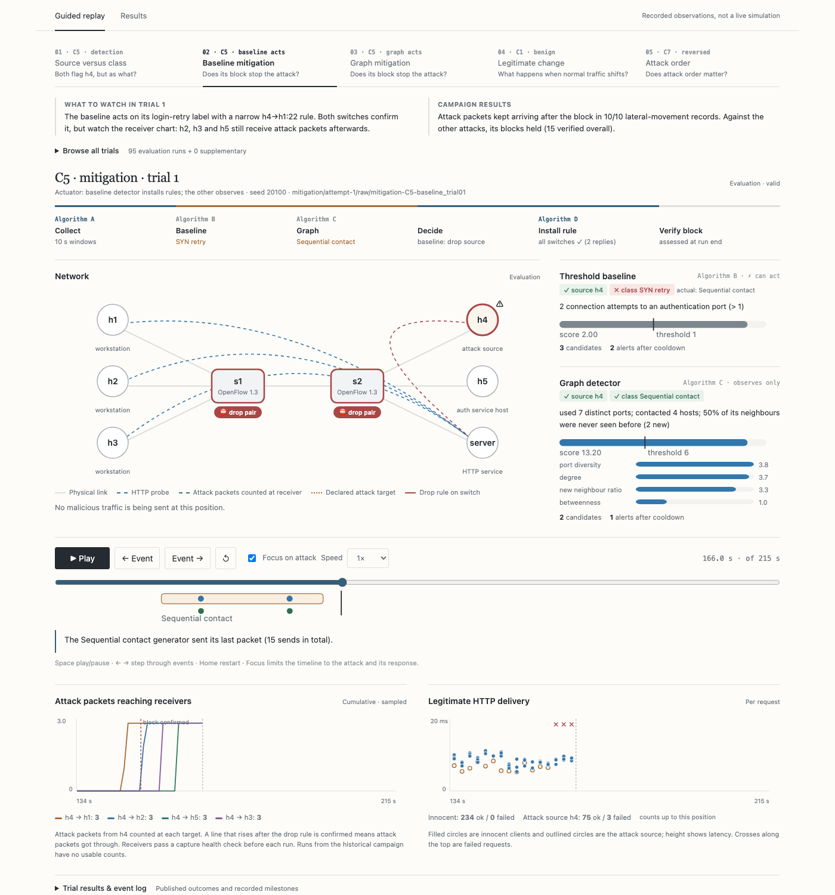
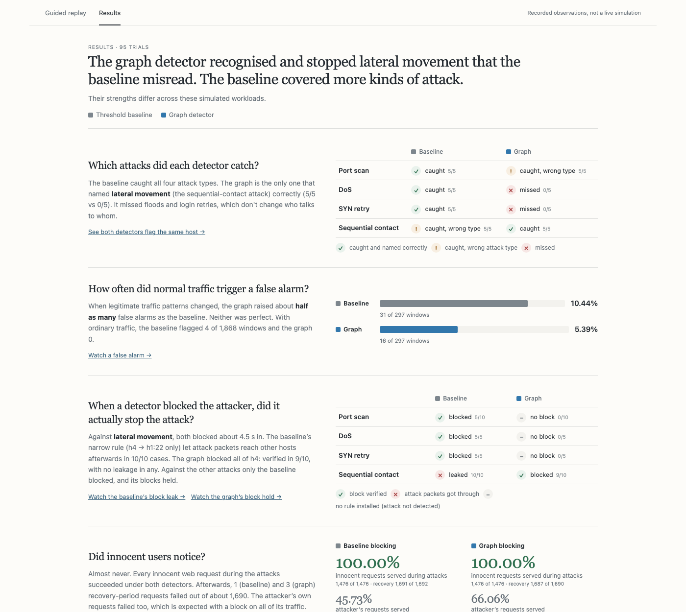
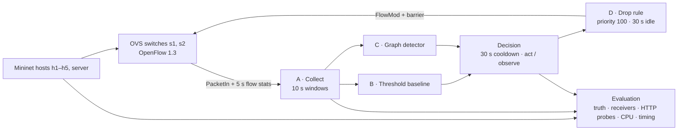
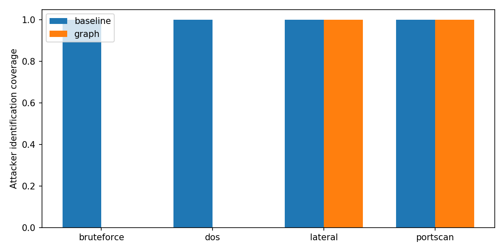

# Lantern

### Graph-based SDN controller-integrated intrusion detection and automated mitigation

**Six hosts · two OpenFlow switches · one Ryu controller · 95 evaluation trials, all valid · receiver-verified blocking**

[Results and conclusion](docs/results.md) ·
[Methodology](docs/evaluation.md) · [Replay guide](docs/replay.md) ·
[Evidence](submission-repaired-20261012/) · [Submission guide](docs/submission.md) ·
[Team](AUTHORS.md)

Lantern runs two intrusion detectors side by side inside a Ryu SDN controller.
Both see the same 10-second observation windows:

- **Threshold baseline (Algorithm B)**: per-source and per-pair rules for port
  diversity, packet rate and repeated SYNs.
- **Graph detector (Algorithm C)**: builds a host-communication graph each
  window and scores every host against its own rolling profile (degree,
  new-neighbour ratio, port diversity, betweenness, community change).

Either detector can trigger **automated OpenFlow drop rules (Algorithm D)**. The
project asks whether network-wide graph structure helps catch and stop internal
lateral movement that threshold rules misread, and what that costs in latency,
controller load and collateral damage.

## Key findings

From the repaired campaign (12 October 2026), where a receiver on every host
counts the attack packets that actually arrive:

| | Threshold baseline | Graph detector |
| --- | --- | --- |
| Lateral movement: attacker **found** | 5/5 | 5/5 |
| Lateral movement: attack **named correctly** | 0/5 | **5/5** |
| Lateral movement: **block verified** | 0/10 (leaked in **10/10**) | **9/10** (no leakage) |
| Attack types detected (scan, flood, SYN retry, lateral) | **4/4** | 2/4 (missed flood, SYN retry) |
| Scan, flood and SYN-retry blocks verified | **15/20** (no rule in 5) | none (no rule) |
| False alarms when legitimate traffic changes | 31/297 windows (10.44%) | **16/297 (5.39%)** |
| Innocent HTTP requests served during attacks | 1,476/1,476 | 1,476/1,476 |
| Compute per 10 s window | 0.15 ms | 1.64 ms |

The two detectors are **complementary**:

- **Both find the attacker.** Both flag h4 in the same window, about 4.5 s after
  the attack starts. That delay is the wait for the window to close, not
  computation.
- **Only the graph names lateral movement.** The baseline calls it a login
  (SYN-retry) attack, because one of the contacts hits SSH port 22.
- **The label decides whether the block works.** Both block about 4.5 s in.
  The baseline's label produces a narrow h4 → h1:22 rule, and the attack goes on
  to reach h2, h3 and h5. The graph's label blocks all of h4, and nothing more
  arrives.
- **The baseline covers more ground.** It detects and blocks scans, floods and
  login retries. Those attacks don't change who talks to whom, and under its
  fixed configuration the graph's score never crossed its threshold for them.

Five trials per condition give wide confidence intervals, and this is one
small emulated topology. See [limits](#limits).

## Quick start

| I want to… | Run | Needs |
| --- | --- | --- |
| **See the experiments** | `python3 -m replay serve --port 8000` → [localhost:8000](http://localhost:8000) | Python 3 only |
| **Read the results** | `python3 -m replay.report` → `output/pdf/results-summary.pdf` and `results-report.pdf` | Python 3 + Chrome |
| **Verify the evidence** | see [Evidence and verification](#evidence-and-verification) | Docker |
| **Re-run everything** | `make campaign CAMPAIGN=results/campaigns/my-run` | Docker (privileged), several hours |

## Watch the recorded experiments

```sh
python3 -m replay serve --port 8000
```



The viewer plays back the saved logs of every trial. It runs no network
experiments and makes no external requests. It has two views:

- **Guided replay**: five chapters (C5 detection → baseline mitigation → graph
  mitigation → legitimate change → reversed order). Each chapter says what to
  watch and gives the result across all trials, computed from the published
  tables.
  - A pipeline strip lights up Algorithms A → B/C → decision → D → verification
    as the run reaches each stage.
  - Detector cards show whether the source and the attack type were right, plus
    the score against its threshold.
  - The receiver chart shows attack packets arriving at each target, so you can
    watch the baseline's block leak and the graph's hold.
  - **Focus on attack** zooms past the 135 s warmup.
- **Results**: a one-line verdict, then five plain questions, each answered with
  one picture: which attacks were caught, how often normal traffic caused false
  alarms, whether blocking actually worked, whether innocent users noticed, and
  what the graph costs. Links jump to the replay moment behind each answer.



Keyboard: Space play/pause, ← → step through events, Home restart. Links can
open a chapter at a moment: `#replay&chapter=2&at=confirm` jumps to the block,
`at=detect` to the first flag, or `t=150` to a given second. The trial browser
covers all 95 evaluation trials.

To replay the earlier, historical campaign instead:

```sh
python3 -m replay serve --port 8000 --submission submission
```

To export a portable copy:

```sh
python3 -m replay export --output output/lantern-replay.zip
```

Extract it, enter `lantern-replay/`, and run `python3 serve.py --port 8000`. The
server checks every file against its checksum inventory before it starts, and
it binds to localhost only.

## Results documents

```sh
python3 -m replay.report
```

This verifies every curated checksum, then writes two PDFs to `output/pdf/`:

- **`results-summary.pdf`** (5 pages): the conclusion first, then the five
  evaluations (detection, false alarms, blocking, innocent users, cost), each
  with one result, one picture and why it happened.
- **`results-report.pdf`**: the same summary plus appendices: every detection
  trial, every blocking record, delivery latency, cost per condition, rule
  timing, the measurement repair, Review 1 traceability and provenance.

The documents and the viewer compute their numbers with the same module,
[replay/summary.py](replay/summary.py), which reads only the published tables.

## Architecture



| Case | Workload | Tests |
| --- | --- | --- |
| C1 | Normal synthetic traffic plus real HTTP probes | False-positive rate |
| C2 | TCP SYN sweep across many ports, repeated for 40 s | Scan detection |
| C3 | 1,500 packets/s flood for 40 s | High-rate anomaly |
| C4 | Repeated SYNs to an auth port for 40 s | Brute-force-style retries |
| C5 | Sequential contact to five internal hosts | Lateral-movement detection |
| C6 | Sequential contact then scan, heavier normal traffic | Disruption under mixed load |
| C7 | Sequential contact → scan → SYN retry (and reversed) | Head-to-head, order effects |

Detection runs disable mitigation. Mitigation runs let exactly one detector act
while the other observes. The thresholds (ports 6, hosts 4, DoS 21 packets/s,
SYN attempts 1, graph score 6) were frozen from normal-only calibration before
any attack was evaluated. The graph's community-change feature compares peer
membership, not community labels.

## Repository layout

| Path | Contents |
| --- | --- |
| `lantern/` | Ryu application: collector, features, both detectors, decision, mitigation |
| `experiments/`, `traffic/`, `topo/` | Case definitions, campaign runner, traffic generators and receivers, Mininet topology |
| `tests/` | Research unit/regression suite (90 tests) |
| `submission-repaired-20261012/` | **Current evidence**: raw logs, published tables, manifest, checksums |
| `submission/` | Historical evidence (22 September 2026); its receivers could not observe traffic |
| `replay/` | Evidence viewer, shared result summary, PDF builders, and their tests |
| `docs/` | Conclusion, results, methodology, replay and submission guides |

`replay/` is deliberately kept outside the frozen experiment source inventory,
so changing the viewer or the reports never changes the evaluated source hash.

## Setup and quick checks

Requirements: Docker with Linux containers, Python 3 on the host, and Git.
The container supplies Ryu, Mininet, Open vSwitch, Scapy, and the analysis tools.

```sh
make build
make validate
make datapath-check
make integration
```

Unit tests and analysis do not need privileged containers. Network experiments
need privileges to create namespaces and virtual interfaces. Userspace OVS needs
checksum and segmentation offloads disabled, and the runner does this before
generating traffic. A ping-only check cannot verify TCP service delivery.

For a single demonstration run:

```sh
make run-case CASE=C5
```

By default this observes without blocking. To demonstrate graph mitigation, use
a distinct label so existing evidence is never overwritten:

```sh
docker run --rm --privileged --network none -v "$PWD:/opt/lantern" \
  lantern-sdn-ids python3 -m experiments.run_case \
  --case C5 --label demo-C5-graph --mitigator graph --seed 9101
```

Replay tests (no Docker needed):

```sh
python3 -m unittest discover -s replay/tests -t .
node replay/tests/model.test.mjs   # optional; Node is not a viewer dependency
```

## Reproduce the evaluation

```sh
make plan
make campaign CAMPAIGN=results/campaigns/my-submission
make analyze CAMPAIGN=results/campaigns/my-submission
```

A campaign runs a pilot, three normal-only calibration trials and 95 evaluation
trials: 35 detection + 50 mitigation + 5 benign variation + 5 reversed order.
Expect several hours; the pilot prints a measured estimate. Every trial gets a
fresh container, and every receiver must pass a capture health check or the
run is invalid. Failed attempts stay on disk and are retried once. Two failures
stop the campaign for diagnosis. The repaired campaign itself was produced with
[scripts/run_repaired_campaign.sh](scripts/run_repaired_campaign.sh), which
imports the historical calibration instead of re-calibrating.

For staged execution or resumption:

```sh
python3 -m experiments.campaign create --campaign results/campaigns/my-submission
make pilot CAMPAIGN=results/campaigns/my-submission
make calibrate CAMPAIGN=results/campaigns/my-submission
make evaluate CAMPAIGN=results/campaigns/my-submission
```

Use either the all-in-one command or staged creation for a given folder, not
both. Successful trials are kept on resumption. Source changes require a new
campaign, and thresholds are frozen before evaluation.

## Evidence and verification

The current campaign is `results/campaigns/submission-20261012-measurement-v3`.
Its curated evidence lives in `submission-repaired-20261012/`. All 95 evaluation
trials passed validity checks, and all 570 receiver logs passed their capture
health checks.



Verify the evidence (every checksum, plus exact regeneration of every published
table) and build the submission archive:

```sh
make build
make validate
docker run --rm --network none -v "$PWD:/opt/lantern" --entrypoint python3 \
  lantern-sdn-ids -m experiments.package verify --submission submission-repaired-20261012
docker run --rm --network none -v "$PWD:/opt/lantern" --entrypoint python3 \
  lantern-sdn-ids -m experiments.package archive --submission submission-repaired-20261012 \
  --output output/lantern-submission-repaired-20261012.tar.gz
```

`make verify` and `make package` still default to the historical `submission/`
folder; the Makefile is part of the frozen source, so it was left unchanged.
The archive is built from an explicit allowlist (source, documentation and the
chosen evidence, placed at `lantern/submission/`), gets a SHA-256 sidecar, and
is never overwritten. It does not include the replay; ship that with
`replay export` above.

To reproduce from an extracted archive:

```sh
tar -xzf output/lantern-submission-repaired-20261012.tar.gz -C /path/to/empty-directory
cd /path/to/empty-directory/lantern
make build
make validate
make verify
```

To curate a new campaign, choose a new destination so the included evidence is
preserved:

```sh
docker run --rm --network none -v "$PWD:/opt/lantern" --entrypoint python3 \
  lantern-sdn-ids -m experiments.package curate \
  --campaign results/campaigns/my-submission --submission submission-new
```

These files form the audit trail:

- [manifest](submission-repaired-20261012/manifest.json)
- [validity table](submission-repaired-20261012/tables/validity.csv)
- [result-to-evidence map](submission-repaired-20261012/tables/evidence_map.csv)
- [checksums](submission-repaired-20261012/checksums.json)
- per-attack [blocking](submission-repaired-20261012/tables/containment.csv) and
  its [summary](submission-repaired-20261012/tables/blocking_summary.csv)
- per-trial [delivery](submission-repaired-20261012/tables/disruption.csv) and
  [overhead](submission-repaired-20261012/tables/overhead.csv)

## Limits

- **Simulated attacks.** Repeated SYNs do not authenticate, and sequential
  contacts do not demonstrate real compromise or propagation.
- **One baseline.** It is this implementation's source/pair threshold detector.
  Its lateral-movement mislabel comes from rule order and thresholds; a
  different rule priority might fix it without a graph, which was not tested.
- **Small, dependent samples.** Five trials per condition. Live scheduling
  varies even with seeds. Multi-attack observations within a run share
  adaptive profiles.
- **Order sensitivity.** Profiles keep learning during evaluation. With the
  attack order reversed, the graph caught the scan in 1/5 trials and the SYN
  retries in none.
- **Verification is sampled.** A verified block means stable receiver counts
  across the sampled interval after confirmation, not a lossless wire capture.
  Source-wide drop counters can include the attacker's legitimate traffic.
- **Combined policy not evaluated.** Pairing the baseline's breadth with the
  graph's label is the recommendation, not a measured result.
- **TCAM is a proxy.** Flow-table entries measure software occupancy, not
  hardware TCAM.
- **Out of scope:** ML classifiers, Suricata, redirection, production deployment
  and multi-controller scaling.

The historical campaign (`submission/`, 22 September 2026) is kept for the
record. Its receivers listened on loopback and counted nothing, so its blocking
results are superseded; its detection results showed the same pattern.

If service delivery fails, inspect run validity and process logs before
interpreting any detection result. If the datapath gate fails, use a Linux host
or a Linux VM with working userspace OVS. Do not run concurrent campaigns on the
same machine while measuring overhead.
